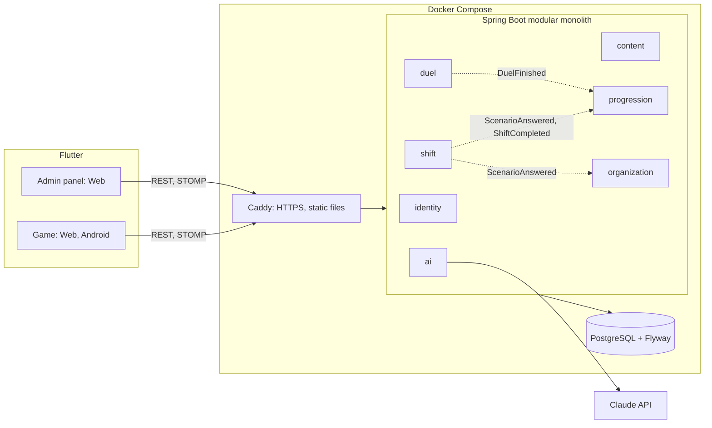

# KÖDER

**Phishing defence as a daily game.** Five minutes a day you work a shift in a simulated office: emails, texts, calls, QR codes and sign-in prompts arrive, and you decide what is an attack. Fall for one and your phone gets "hacked" before your eyes. Then you duel colleagues, or the jury, in real time.

Hackathon project of students at Westsächsische Hochschule Zwickau. Flutter (game and admin panel) and Spring Boot (modular monolith).

## Run it

You need Docker, and Flutter 3.32 to build the web apps.

```powershell
copy .env.example .env          # then set KOEDER_JWT_SECRET and KOEDER_DEMO_PASSWORD
.\scripts\build_web.ps1         # scripts/build_web.sh on Linux and macOS
docker compose up -d --build
```

| What | Where |
|---|---|
| Game | http://localhost/ |
| Admin panel | http://localhost/admin/ (`thomas@muster-automotive.example`, password from `.env`) |
| API documentation | http://localhost/swagger-ui/index.html |
| Health | http://localhost/actuator/health |

Set `KOEDER_DOMAIN` in `.env` on a server and Caddy obtains HTTPS automatically. Phones in the same network can use the laptop's IP address as a fallback.

The game also runs with no backend at all, for example with `flutter run -d chrome`: it detects the missing server and plays locally, with a local bot as the duel opponent.

For Android: `flutter build apk --dart-define=API_BASE=https://your-domain`. The Android build needs JDK 17; Gradle 8.12 does not run on JDK 25.

## What is in it

| Mode | What it does |
|---|---|
| **Working shift** | 8 messages arrive in an inbox, half of them genuine. Calls and sign-in prompts interrupt you. Tap a sender to see the real address, long-press a link to see where it goes |
| **HACKED sequence** | A GLSL shader tears apart a snapshot of the screen, followed by a fake ransomware screen, then a calm debrief with red flags marked on the message |
| **Simulators** | Mail, SMS, messenger, browser with address bar, incoming call with text-to-speech and a dialogue tree, QR, MFA fatigue push spam, file manager, on-site situations |
| **PvP duel** | 5 rounds over STOMP: same scenarios for both, server-side timing and scoring, ELO, emoji reactions. By ranked queue, code or QR, with a bot as fallback. Players with different languages can duel |
| **Arena** | One QR code on a slide: everyone who scans is paired up within seconds |
| **Swipe**, **Spot the flags** | Fast verdicts in 60 s; tapping the suspicious parts of a message |
| **Case files** | Replay Binance 2019, Twitter 2020 and Uber 2022 and try to stop the attack |
| **Become the hacker** | Build bait from fixed blocks and watch 100 simulated colleagues react. No free text, no export, fictional company |
| **Check a message** | Paste a suspicious message and get a verdict. Claude if a key is set, otherwise a local rule engine, and the UI says which one answered |
| **Simple mode** | Large type, no timers, no rankings, everyday scams only |
| **Company dashboard** | Human Risk Score, heatmap of department by attack type, trends, live feed, audit PDF, scenario generator with human review |

Also: 13-module learning path, spaced repetition (1, 3, 7, 14, 30 days), XP and job titles from intern to CISO, streaks with freezes, weekly leagues, badges, German and English, data export and account deletion.

## Architecture



The modules talk through Spring application events and small public APIs. `ModularityTest` fails the build if a module reaches into another module's internals or a cycle appears. The generated module diagram is in [docs/architecture/modules.puml](docs/architecture/modules.puml).

**Why a monolith?** One deployment is right for one night and one server, while the verified boundaries keep any module, say `duel`, extractable later.

**The contract is enforced.** The app talks to the API through a client generated from the OpenAPI document (`scripts/gen_api.sh`, output in `app/packages/koeder_api`). `OpenApiContractTest` fails if the API and the committed document drift apart.

**Content is data.** All scenarios live in [content/](content/) as JSON, validated against a JSON Schema at startup and in tests. Tests also check that German and English cover the same scenarios, that about half the messages are genuine, that only reserved domains are used, and that every red flag quotes text that really exists. After editing content, run `dart run tool/sync_content.dart` in `app/` to update the offline bundle.

## Security and privacy

- **No personal link in company statistics.** An answer becomes a counter on department, day and attack type, and the user id is dropped at that point. The employer cannot reconstruct who clicked what. Departments under 5 people show no numbers.
- **Anti-cheat.** The solution is not sent before a round ends. The server measures time, accepts one answer per round, and ignores late answers.
- JWT with roles, also checked on the WebSocket. A company's live feed is visible only to managers of that company.
- Bean Validation, parameterised SQL, rate limiting on login and AI, secrets only in the environment, Postgres not published.
- Fonts, CanvasKit and sounds are bundled, so nothing is loaded from third parties.
- All domains in scenarios use reserved zones (`.example`, `.test`), and brands are invented.
- Account deletion cascades through every table holding personal data; export returns all of it as JSON.

## Tests

```powershell
cd backend; mvn verify          # needs Docker for Testcontainers
cd app; flutter analyze; flutter test
```

The backend suite covers ELO, scoring, Leitner, streaks, shift planning, risk score, rule engine, content rules, module boundaries, the API contract, and full flows against real Postgres, including two STOMP clients playing a complete match.

## Demo configuration: turn off for anything real

`KOEDER_DEMO_ENABLED=true` seeds a company with **synthetic** history (labelled in the UI and in the PDF), opens the "reset the day" endpoint, and with `KOEDER_DEMO_AUTO_JOIN=true` adds every guest to that company so the dashboard moves live.

## Known limits

- The web and app bundles contain scenarios with solutions for offline play, so a determined player could look up duel answers. The server still decides timing and score. A production build should bundle only a separate offline pack.
- Practice modes have no replay limit, so XP can be farmed there. Shifts are protected.
- Matchmaking and running duels live in memory on one instance. Scaling out needs an external broker and shared state.
- Plans and prices are shown as a preview; there are no payments.

See [docs/DEMO.md](docs/DEMO.md) for the stage script (in Russian).
